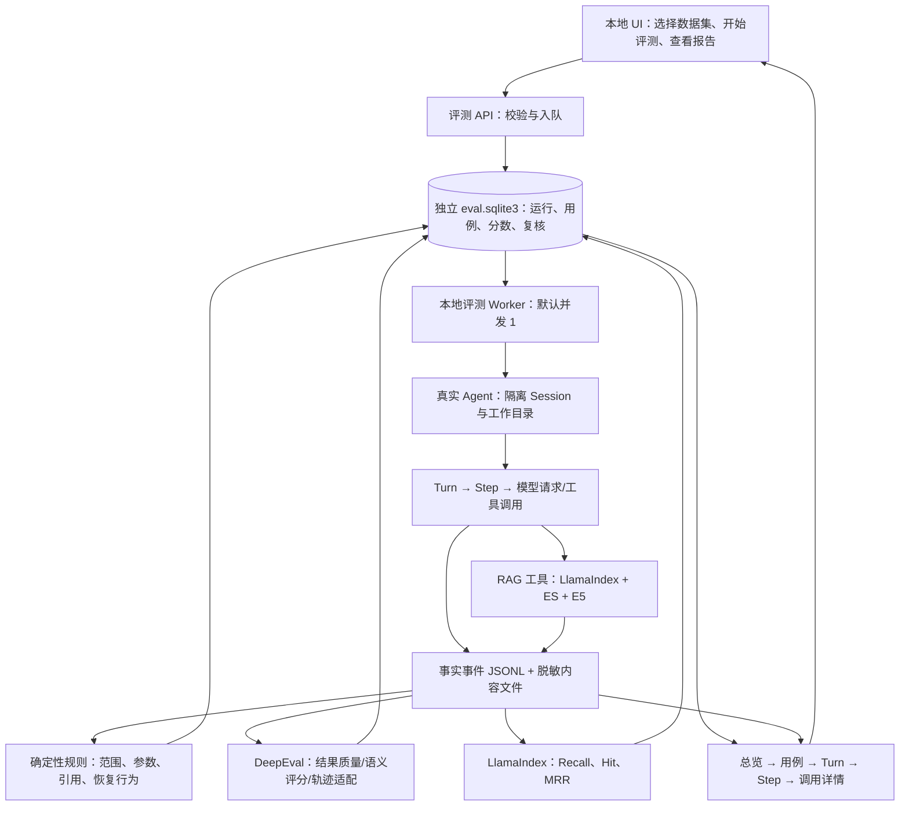

# mini-harness Agent 端到端评测改造计划

日期：2026-10-13。状态：阶段 0 已完成，阶段 1–8 待实施。DeepEval 已在隔离环境验证；尚未接入真实评测运行器或上线评测页面。

## 1. 目标与结论

建立“数据集 → 真实 Agent 执行 → 完整 step 轨迹 → 自动评分 → 人工复核 → bad case 回归”的本地闭环。沿用当前 Python、SQLite、JSONL、LlamaIndex 和本地 UI；适配 16GB 内存、4GB 显存，不要求 Docker。

阶段 0 实测发现 DeepEval 与当前 Hugging Face 的 click 约束冲突，故使用独立 `.venv-eval` 评分进程，通过 JSON 契约与主环境交换数据；原 `.venv` 保持原版本。详见 [阶段 0 报告](docs/agent-evaluation-stage0.md)。

选择：DeepEval 作为端到端及语义质量评估库；LlamaIndex RetrieverEvaluator 继续计算检索指标；mini-harness 自己负责执行任务、事实日志、本地存储及 UI。框架负责评分能力，不负责替代 Agent loop。

评测分三个视角：最终任务完成质量、Agent 执行轨迹、RAG 组件质量。在线追踪只记录事实；有标准答案或明确评分规则时才做质量评测。

## 2. 工具调研与取舍

| 候选 | 官方能力 | 对本项目的适配判断 |
|---|---|---|
| DeepEval | Python 端到端、多轮、轨迹/组件评估；工具正确性、任务完成、忠实度等指标 | 主选。便于把现有 Python 事件转为测试用例，自建 UI 可复用评分库；语义指标通常需要 judge，须明确指定模型 |
| Promptfoo | Python 自定义 provider、断言、批量比较和 OpenTelemetry 追踪 | 可行备选。适合配置驱动的多模型比较；本项目已有 Python/UI，增加另一套运行入口和 Node 工具链收益较小 |
| Ragas | RAG 指标，也提供工具调用及 Agent 目标指标 | 可行；检索指标与已有 LlamaIndex 重叠。当前更需要统一端到端和工具行为评测，因此本期不额外引入 |
| LangSmith | 数据集、实验、线上/离线评估、追踪 | 团队协作有价值；当前优先本地文件与现有 UI，不为本期引入另一套平台。自托管条件应按实际版本/部署方案另核验 |
| Phoenix | 自托管追踪与评测平台 | 若后续需要跨应用的统一追踪平台可考虑；本期嵌入现有 UI，不再运行独立可观测平台 |
| LlamaIndex | 已接入检索评估器及 CallbackManager | 保留；不能仅凭检索指标判断 Agent 整体成功 |

此选择是按项目约束作出的工程判断，不是行业排名。实施第一阶段锁定验证过的 DeepEval 版本；检查与现有 llama-index-core/Pydantic 依赖兼容性，再确定固定版本，不直接安装 latest 覆盖环境。

DeepEval 采用本地调用与本地报告；不配置托管平台自动上传，关闭匿名遥测。显式传入 judge，禁止遗漏配置后意外使用默认模型。具体本地模式、关闭上传设置须在锁定版本中验证。DeepEval 当前单轮、多轮、轨迹 API 有差异，由适配器隔离，不把三种用例强塞进同一执行 API。

## 3. 当前基础与缺口

已有：turn/step/model/tool 事件、JSONL 持久化、UI step 详情、LlamaIndex retrieve/BM25/embedding/kNN/fusion 追踪；20 个单论文检索问题（12 开发、8 已观察留出），Recall/Hit/MRR；4 类回答的小样本复核。

缺少：正式 Agent 数据集、完整模型请求快照、独立模型请求 ID、跨层统一结果模型、错误分类、证据真正进入上下文的记录、语义评分、可重启的评测任务、实验比较 UI。

现有检索和答案验收未全部达标。原 8 道留出题已被查看，此后作回归集，不能再称为全新盲测集。新体系的接入不等于产品质量过关。

## 4. 架构



Agent 执行和 judge 评分分开：先保存事实，再评分。评分失败可重试评分，无需重新执行整个 Agent。历史轨迹回放只能证明旧执行的评分结果，验证代码修复必须重新运行 Agent。

## 5. 执行单位与详细记录

层级：run_id → case_id → attempt_id → session_id → turn_event_id → step_event_id → model_request_id / tool_call_id → span_id。模型重试、引用修复各有独立 request_id 和 purpose；不把多次 API 调用混成一次。工具内部 RAG span 保留 parent_span_id。

Turn 是一次用户输入的处理流程；Step 是一次 loop 迭代，包含模型请求及本次返回的全部工具执行。无工具的最终回答也是一个 step。以实际事件 ID 关联，不依赖恢复后可能重置的 turn 数字。

| 层级 | 记录内容 |
|---|---|
| 运行 | 数据集/代码/提示词/工具 schema/模型/解析分块/embedding/索引配置摘要，运行模式、时间、随机参数、评测器版本、judge 配置 |
| 用例 | 输入与预置历史、每轮论文选择范围、预期结果、实际答案、执行状态、任务成功判定、失败分类、重跑次数 |
| Turn | 用户输入、有效范围、起止时间、steps 数、各类模型/工具次数、总 token、最终答案、引用、停止原因 |
| Step | 起止、总耗时、实际输入输出引用、模型请求列表、计划工具与实际工具、证据变化、结束原因、错误、下一步关联 |
| 模型请求 | 最终发送的 messages 和工具 schema 的脱敏快照，原始可见回复/工具参数，模型及参数、provider request ID、API usage、耗时、重试原因、usage 缺失情况 |
| 工具 | 名称、版本、完整脱敏参数/返回内容引用、排队与执行时间、结果大小、状态、结构化 error_code、超时、是否重试及是否属于重复无效调用 |
| RAG 查询 | 原 query/改写 query、实际过滤范围/版本、两路候选 ID/分数/排名、RRF 贡献、融合后排名、top_k、去重数量、各阶段耗时 |
| read_section | 章节路径、实际命中 SourceBlock、页码/原文、选中版本、读取数量、提供数量、预算排除数量及原因、读取耗时；无向量搜索时向量分数显示不适用 |
| 上下文 | 搜索返回 → ledger 接受 → 本次请求实际注入 → 最终引用，逐段可追踪；记录去重/预算/失效原因及前后 token 数 |
| 评分 | metric/version、单位、评分对象 ID、值、阈值、分母、通过状态、理由与证据引用、judge 请求成本、人工覆盖记录 |

请求快照必须捕获最终请求边界，包含裁剪/摘要及证据注入之后的实际内容，不能靠事后拼 session 假装原始输入。只记录可观察消息和工具行为，不要求模型暴露隐藏思维链。

性能口径：step/turn 墙钟耗时与子调用时间分别展示；父子 span 不重复相加。模型成本与 judge 成本分别统计；API 未返回 usage 显示未知，不能补零。首 token 延迟仅在将来实际流式埋点后启用。P50/P95 展示样本数、冷热状态；小样本不做稳定性能结论。

## 6. RAG 分数和“置信度”

展示 BM25 原始分数、向量原始分数及度量、RRF 融合分数和名次；若后续启用 reranker 再展示其模型/分数。当前未启用重排序模型，不能显示伪造的 rerank 值。

上述分数都不是“答案正确概率”，也不能跨不同查询直接比较大小来判定可信度。UI 标签使用“检索分数”，不显示“置信度 95%”。

另显示证据支持度：由显式 judge 或人工判断“此证据是否支持该结论”，保留判断理由和原文定位；标明这也是评估分数，不是校准概率。若未来要概率化置信度，需独立人工标签、校准方法与 Brier/ECE 等校准检验，本期不承诺。

## 7. 指标目录与判定口径

每项指标以统一注册表声明 scope、单位、方向、依赖字段、算法版本、阈值和 UI 展示方式；同一注册表驱动后端评分与前端列，不遗漏已实现指标。

| 维度 | 指标 | 计算者/条件 |
|---|---|---|
| 最终任务 | 任务成功率、需求覆盖率、答案相关性、事实正确性 | 可验证事项用规则；开放答案用 DeepEval GEval/任务指标及人工；多轮按独立会话 rubric |
| 证据质量 | 忠实度、逐结论引用支持率、应引用结论的引用覆盖率 | Faithfulness + 自定义结论/引用评审；以模型实际收到的证据为上下文 |
| 引用结构 | ID/版本/页码有效率、越范围引用数 | 代码规则；结构有效不代表语义正确 |
| 拒答与恢复 | 应拒答命中率、可回答题误拒答率、错误后给出有效下一步的比例 | 标注 answerable 与 expected_behavior；区分无证据、未选范围、服务故障 |
| 工具行为 | 工具选择正确性、参数合法率/语义正确性、范围违规数、前置条件满足率 | DeepEval ToolCorrectness + 本地规则；不要求唯一固定调用序列 |
| 轨迹效率 | steps/模型调用/工具次数、重复无效调用率、重试与引用修复次数、超预算率 | 事件统计；重复调用需结合参数、状态和重试策略判断 |
| 检索 | Recall/Hit/MRR@1/3/5 | 保留 LlamaIndex，依赖 gold evidence；每次 search 与用例跨调用证据覆盖率分开 |
| 上下文 | 返回/接受/注入/引用证据数量，预算占用率，去重与预算排除率 | 自定义事实统计；有 gold 时另算实际注入上下文的证据覆盖率 |
| 性能 | turn/step/model/tool/RAG 分段耗时，P50/P95、吞吐、排队时间 | 单调时钟与 trace；按相同配置/并发比较 |
| 成本资源 | agent/judge 输入输出 token、缓存 token、已知价格下费用、峰值 RSS | API usage/版本化价格表/进程采样；ES 内存另列、费用不完整显式标记 |
| 稳定性 | 执行错误率、评分错误率、恢复成功率、重复运行成功分布 | 多次独立执行，显示样本数；执行 completed 不等于任务成功 |

总览不可只给一个平均总分。硬性失败（越界、伪造引用、破坏性写入）独立显示；无 gold、无价格、无流式数据时显示“不适用/缺少数据”，不当作零。分母与有效样本数可点开。任务成功率以已判定用例为分母，并同时显示未判定与错误数，发布门禁不能忽略未判定项。

judge 用统一 rubric、固定版本和低随机性；保存可见评分解释，并在一小组人工样本上校验一致性。同模型自评有偏差；可用另一已配置模型复核争议样本。评测器异常归类为 judge_error，不直接判定 Agent 回答错误。

## 8. 数据集与案例设计

一期 JSON/JSONL，UTF-8，schema_version 固定；文件夹可包含多个数据集。禁止数据集携带可执行 Python、shell 或任意系统提示覆盖。CSV 导入后续再做。

每例含：case_id/category/split、scenario、turns（input、selected_papers、可选状态变化）、expected_behavior、reference_answer/key_points、gold_evidence（paper logical key、版本摘要、SourceBlock/页码/内容摘要及当前 chunk 映射）、tool_constraints、budgets。标准答案/金标不注入 Agent 输入，只交评分器。

```json
{
  "schema_version": 1,
  "dataset_id": "paper-agent-regression-v1",
  "cases": [{
    "case_id": "scope-empty-after-success",
    "category": "scope_recovery",
    "split": "regression",
    "scenario": "历史中读过论文，本轮取消选择后再提问",
    "turns": [
      {"input": "请介绍 SparseBEV 的核心思想", "selected_papers": ["SparseBEV"]},
      {"input": "它的突出创新点是什么？", "selected_papers": []}
    ],
    "expected_behavior": "说明本轮未选择论文并引导选择，不断言整个论文库为空",
    "tool_constraints": {"respect_selected_scope": true},
    "budgets": {"max_steps_per_turn": 10}
  }]
}
```

逻辑论文名须通过数据集 manifest 映射到当前 catalog 的唯一 paper_id/版本；同名歧义或版本摘要不一致则运行前报错。不能把金标 chunk ID 当作稳定跨分块标识。

建议第一版人工复核 30–50 个场景，覆盖多篇论文：方法问答、公式/表格、章节上下文、中文问题英文证据、多论文比较、批注与原文分离、无答案、范围切换、版本变化、ES/工具异常、证据预算、重复失败恢复。用例数是建设目标，不是当前已有资产。

将 66f807 的 Turn10/11 抽成最小可复现案例，分别评价“明确范围原因/给出下一步/不伪造论文结论”；Turn11 只能算恢复提示较好，不算已回答创新点。历史回放保留旧失败；修复对照使用相同前置状态重新跑。

故障注入仅允许评测环境中的声明式 fixture，例如单个工具抛指定错误，不停用户真实 ES。每例隔离 Session；多轮例内部共享；不同例不共享证据账本。固定历史回放与完整多轮实跑单独标注。

## 9. 本地执行与持久化

UI 提交后立即返回 run_id，由独立评测 Worker 执行。默认同时一个运行、一个用例，复用模型缓存；避免与导入任务争抢内存。运行前检查 ES、模型、catalog、语料摘要、judge 配置、配额；允许不启用 judge 的规则/检索评测。

执行模式：A 真实 Agent + 规则评分；B 真实 Agent + 规则/语义评分；C 已有轨迹仅重新评分。明确标记模式、实际请求与费用边界。调用现有远程模型时，开始按钮附近说明会发送的题目/选中证据/回答以及 judge 目的地；此前四题验收授权不视为所有新数据集的无限授权。

独立 SQLite 表：datasets、runs、case_attempts、trace_index、metric_results、artifacts、human_reviews。run 状态与判定分离：queued/running/cancelling/completed/failed/interrupted；质量 verdict 为 passed/failed/incomplete。

大内容写 .mini-harness/evals/<run_id>/<case_id>/<attempt_id>/，包括 trace.jsonl、内容寻址的脱敏请求/输出 JSON、report.json；SQLite 只放摘要、索引和相对路径。临时文件写完并原子替换后，再提交数据库引用；重启标记 interrupted，按新的 attempt 重跑未完成例，不伪称从半个模型调用无损继续。

取消在安全边界停止，正在等待的网络调用受超时约束；保留已有结果。导出 JSON/CSV/HTML；存储清理按明确运行 ID 操作，并同步删除引用和产物。UI 预览可截断，但明确截断状态、支持按需读取完整脱敏内容。

评测只能在隔离 workspace 操作写工具；默认论文只读工具白名单。事件脱敏覆盖密钥、认证头及环境秘密。数据集选择范围与文件读取受选定根目录约束；拒绝路径穿越、重解析点越界和巨型文件。

## 10. UI 方案

侧栏新增“评测中心”，普通聊天继续保留当前紧凑 step 入口。所有评测指标在评测中心可查，按层级展开，避免往聊天末尾堆叠。

入口流程：选择文件夹 → 选择数据集文件 → 校验/预览用例 → 选择模式与评分模型 → 开始评测。

浏览器文件夹选择使用目录文件输入上传到本地服务，再从选中目录文件列表挑选 JSON/JSONL；浏览器不会可靠提供任意绝对磁盘路径，不声称可直接访问全盘。兼容回退为单文件选择。实现时可加本地受限目录浏览 API，但不能依赖浏览器未授予的文件访问权限。

```text
评测中心  [新建评测] [历史运行] [Bad cases]
数据集文件夹 [选择文件夹]  数据集 [paper-agent.json ▾]
校验：36例 / 3篇论文 / 版本匹配；缺失字段定位到 case
模式 [真实执行+语义评分 ▾]  judge [已配置模型 ▾]
高级：分组、重复次数、超时、token预算、基线、并发1
[开始评测]

运行：18/36  执行中  评分中3  [取消]
任务成功 / 引用支持 / 工具错误 / P50-P95 / Agent与Judge token
质量状态与执行状态分开；卡片显示样本数和评分覆盖率

用例 | 类别 | 执行 | 质量判定 | 耗时 | token | 首个失败位置
点击用例 → 输入/预期/实际答案/评分理由/引用原文/人工复核
  Turn 1
    Step 1  模型请求 → list_papers → 结果
    Step 2  模型请求 → search_papers → BM25/向量/融合
    Step 3  模型请求 → read_section → 注入证据
    Step 4  模型请求 → 最终回答
```

Step 详情标签：输入快照、模型输出、工具详情、RAG 候选、实际上下文、耗时与token、评分、错误。RAG 表逐条显示 chunk、页码、两路名次/分数、RRF、是否注入/引用、gold 命中（若有）；点击查看原文。运行指标总览 → 分组 → 用例 → step → span 均可下钻。

历史比较要求相同数据集/语料/指标版本，否则醒目提示不可直接比较；显示成功↔失败变更、延迟与token变化。支持把失败例加入回归数据集草稿，经用户复核保存；保留原始结果和人工判定，不覆盖历史分数。

## 11. 分阶段实施及验收

| 阶段 | 主要文件建议 | 交付与验收 |
|---|---|---|
| 0 依赖与契约（已完成） | pyproject.toml、evaluation/models.py | DeepEval 可选依赖兼容；锁版本；确认本地记录、不自动上传；固定指标/schema |
| 1 轨迹完善 | agent.py、client.py、telemetry.py、evaluation/trace.py | request/step/tool关联完整，真实请求快照及错误码；重试、修复、工具失败均可定位 |
| 2 RAG 明细 | rag/hybrid.py、adapters/tracing.py、plugin.py、citations.py | 排名分数、read_section及证据注入路径完整；分数不冒充概率 |
| 3 数据集与任务 | evaluation/dataset.py、store.py、runner.py | JSON/JSONL校验、版本映射、隔离执行、取消/中断/重跑；标准答案不泄漏 |
| 4 规则及检索评测 | evaluation/rules.py、metrics.py | 范围/引用/恢复判定；复用现有 LlamaIndex 指标且与历史结果可对照 |
| 5 DeepEval 适配 | evaluation/deepeval_adapter.py、judge.py | 最终答案、工具、语义评分；单轮/多轮分开；judge 失败可仅重评分 |
| 6 UI 执行入口 | ui.py、ui.html或拆分静态资源 | 选文件夹/文件、预览、开始、进度、取消、历史、运行前问题提示 |
| 7 UI 诊断比较 | 同上及 report.py | 所有已实现指标由注册表展示，可下钻 step；原文、评分理由、基线比较、导出 |
| 8 基准与回归 | datasets/agent/、docs/agent-eval-runbook.md | 人工审定用例/阈值；66f807覆盖；重复运行与独立新数据集报告 |

实施时使用确定性 fixture 验证运行器与数据关联，真实模型小批验证评测适配；真实运行需预算和数据范围明确。单元测试通过、页面可用、评测管线可跑、Agent质量达标四者分别汇报。

首期发布门槛：运行记录不丢关联、无跨用例污染、错误可恢复、UI能定位范围bad case；质量阈值由人工小样本校准后冻结。默认安全规则零违规；语义评分阈值不凭空当行业标准。回归后再用独立盲测集衡量改进，避免反复调同一题产生虚高分数。

## 12. 官方资料（调研依据）

- DeepEval 端到端、单轮/多轮及轨迹评测边界：https://deepeval.com/docs/evaluation-end-to-end-llm-evals
- 工具正确性：https://deepeval.com/docs/metrics-tool-correctness
- 任务完成评分：https://deepeval.com/docs/metrics-task-completion
- 忠实度：https://deepeval.com/docs/metrics-faithfulness
- 默认 judge 与配置说明：https://deepeval.com/docs/faq
- 本地优先定位：https://deepeval.com/docs/introduction
- 遥测环境变量：https://deepeval.com/docs/environment-variables
- Promptfoo Python provider：https://www.promptfoo.dev/docs/providers/python/
- Promptfoo tracing：https://www.promptfoo.dev/docs/tracing/
- Ragas 指标目录：https://docs.ragas.io/en/latest/concepts/metrics/available_metrics/
- LangSmith evaluation：https://docs.langchain.com/langsmith/evaluation
- Phoenix self-hosting：https://arize.com/docs/phoenix/self-hosting

上述来源支持工具能力；本文件的架构、UI、分期和默认并发属于针对 mini-harness 的设计建议。
